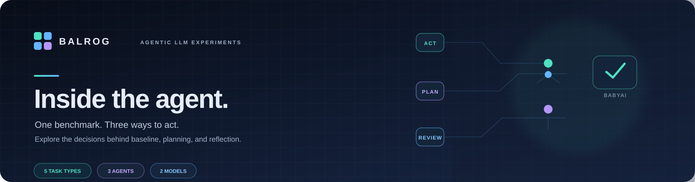
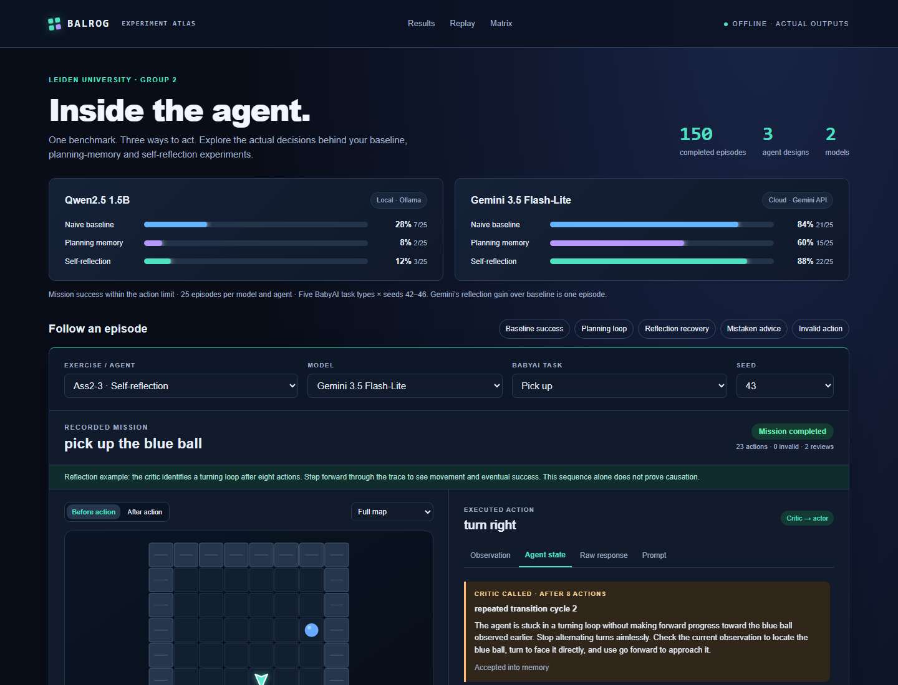

<p align="center"></p>

<p align="center">


</p>

<p align="center"><strong>Inside the agent: one benchmark, three ways to act, and a closer look at the decisions behind each episode.</strong></p>
<p align="center"><a href="#website-preview">Website preview</a> · <a href="#results">Recorded results</a> · <a href="#quick-start">Quick start</a> · <a href="#experiment-details">Experiment details</a></p>

## The question

How do baseline action selection, explicit planning memory, and bounded
self-reflection compare on a small set of BabyAI tasks? What can we learn by
inspecting the agents' recorded decisions, observations, and model responses?

This repository brings together three experiment stages, their saved outputs,
and an interactive dashboard for exploring individual episodes. The agents
were evaluated with a local Qwen2.5 1.5B model and Gemini 3.5 Flash-Lite.

> **Scope:** These are small, exploratory course experiments—not a reproduction
> of the complete BALROG paper or evidence of general reasoning ability.

## Website preview

The standalone dashboard presents the saved experiment results and lets you
filter and replay recorded episodes. Explore the action trace alongside the
agent's observations, prompts, responses, memory, and reflection events.

Open [`index.html`](index.html) in a modern browser. It uses local, saved
outputs; viewing the dashboard does not call an LLM or require an API key.



The screenshot shows the supplied dashboard with a self-reflection episode
selected. It is an actual screenshot of the website, not a recreated mock-up.

## How it works

| Agent design | What happens |
|---|---|
| Naive baseline | The model selects one action from the mission, current observation, and recent history. |
| Planning memory | The model maintains a short plan and immediate subgoal alongside its action selection. |
| Self-reflection | A critic reviews recent behavior after configured loop or scheduled-review triggers; accepted advice is passed to the actor. |

The benchmark covers `goto`, `pickup`, `open`, `putnext`, and
`pick_up_seq_go_to`, with seeds 42–46. The evaluation uses text observations
and one episode per task and seed for each model/agent combination.

## Results

Success means completing the mission within the action limit. Each cell below
contains the observed successes out of 25 episodes.

| Model | Naive baseline | Planning memory | Self-reflection |
|---|---:|---:|---:|
| Qwen2.5 1.5B (local) | 28% (7/25) | 8% (2/25) | 12% (3/25) |
| Gemini 3.5 Flash-Lite (cloud) | 84% (21/25) | 60% (15/25) | 88% (22/25) |

These are descriptive results from small samples, not statistically
significant findings. Planning changes the prompt, memory, and parser together,
so its effects cannot be attributed to memory alone. Reflection adds critic
calls and computation, so it is not an equal-compute comparison. Earlier
results informed later agent designs. See the stage reports for task-level
comparisons and further limitations.

## Experiment details

- **Models:** local `qwen2.5:1.5b` through Ollama and cloud
  `gemini-3.5-flash-lite`.
- **Tasks:** `goto`, `pickup`, `open`, `putnext`, and `pick_up_seq_go_to`.
- **Seeds:** 42–46; one episode per task and seed (25 episodes per
  model/agent combination).
- **Action limits:** 64 for `goto` and `pickup`; 128 for the other tasks.
- **Observation:** text-only, using up to 16 recent observations.
- **Evaluation code:** Python 3.10.21; the recorded BALROG checkout revision
  was `b7afe79e3e4265811cfa985ed7c95c4d1a11e3f5`.

Environment seeds do not make model responses deterministic. Provider-side
model versions may change, and historical baseline and later runs may not have
used exactly the same hosted model version. Exercise 3 also adds critic calls.
These results should not be used to claim general agent capability.

## Quick start

### View the website

Open `index.html` directly in your browser. The page is self-contained and
requires no build step, local server, model, or API key.

### Inspect saved experiments

The saved result files and comparison tables are included in each exercise
folder. To check the Exercise 3 run status without making model calls:

```bash
python Ass2-3/status.py
```

### Run an experiment

Experiments were run with Python 3.10.21 and the upstream BALROG checkout at
the recorded revision. BALROG is not vendored in this repository. First create
and activate an environment, then install the upstream dependency:

```bash
conda create -n balrog python=3.10 -y
conda activate balrog

git clone https://github.com/balrog-ai/BALROG.git
git -C BALROG checkout b7afe79e3e4265811cfa985ed7c95c4d1a11e3f5
python -m pip install -e ./BALROG
```

For local Qwen runs, install and start [Ollama](https://ollama.com/) and
download the model:

```bash
ollama pull qwen2.5:1.5b
```

For Gemini runs, set `GEMINI_API_KEY` in the shell that will run the command.
In PowerShell:

```powershell
$env:GEMINI_API_KEY = Read-Host "Gemini API key"
```

Never commit API keys, `.env` files, or other credentials. Saved results and
the website can be inspected without model access.

Run commands from the repository root. Full evaluations use the `baseline`
profile; without that profile, the runners use a short diagnostic
configuration.

```bash
# Exercise 1: naive baseline
python Ass2-1/run_local.py --profile baseline --seeds 42 43 44 45 46

# Exercise 2: planning/subgoal memory
python Ass2-2/run_exercise2.py --agent custom --profile baseline

# Exercise 3: bounded self-reflection
python Ass2-3/run_exercise3.py --agent reflection --profile baseline
```

For a cloud run, add `--provider gemini` to the corresponding command. For
example:

```bash
python Ass2-2/run_exercise2.py --provider gemini --agent custom --profile baseline
```

Exercise 2 loads its submitted agent from the BALROG checkout. Install that
file before running:

```bash
cp Ass2-2/agent/custom.py BALROG/balrog/agents/custom.py
```

Exercise 3 registers its reflection agent in its runner and does not require
copying an agent into BALROG. The exercise-specific READMEs document resume,
packaging, and other supported options. To resume an interrupted Exercise 3
run:

```bash
python Ass2-3/run_exercise3.py --resume Ass2-3/results/YOUR_RUN_FOLDER
```

## Tests

With the required BALROG and experiment dependencies installed, run the
exercise test suites:

```bash
python -m pytest Ass2-1/test_cloud_runner.py -q
python -m pytest Ass2-2/test_agent.py Ass2-2/test_runner.py Ass2-2/test_comparison.py Ass2-2/test_package.py -q
python -m pytest Ass2-3/test_reflection.py Ass2-3/test_runner.py Ass2-3/test_artifacts.py -q
```

## Repository map

```text
index.html                 Interactive dashboard
assets/banner.svg          Project README banner
assets/dashboard.png       Website screenshot
Ass2-1/                    Naive baseline runner, tests, and saved results
Ass2-2/                    Planning-memory agent, tests, and saved results
Ass2-3/                    Reflection agent, tests, and saved results
```

Each exercise directory also contains its own README, comparison tables, and
additional report or run artifacts. The `results/` folders contain
episode-level data and model-call traces used by the dashboard. Review traces
before redistributing or publishing additional runs because they may include
prompts and model responses.

## Limitations

- Each model/agent comparison has only five task types and five seeds.
- Model outputs are not deterministic, even when the environment seed is fixed.
- Planning memory, prompt design, and parsing change together in Exercise 2.
- Reflection adds model calls and computation; the comparison is not
  equal-compute.
- Earlier results informed the later agent designs.
- Performance on these BabyAI tasks does not establish general reasoning
  ability or reproduce the full BALROG benchmark.

## Teammate acknowledgment

This project was completed with teammate
[Sunil Parameswaran](https://github.com/SunilParameswaran).

## Reports and references

- [Exercise 1 README](Ass2-1/README.md)
- [Exercise 2 README and results report](Ass2-2/README.md)
- [Exercise 3 README and results report](Ass2-3/README.md)
- [Upstream BALROG project](https://github.com/balrog-ai/BALROG)
